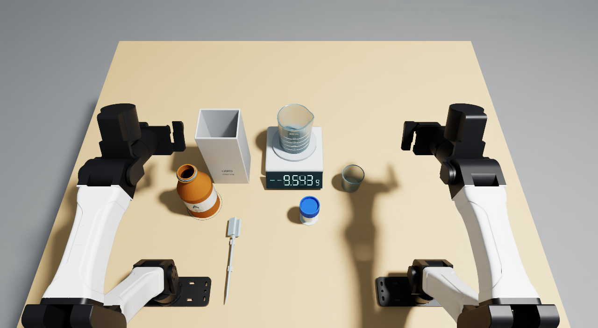

# Correct a liquid dose to 10.000 g

Use a transfer pipette and the balance reading to correct a beaker that starts below or above **10.000 ± 0.050 g**. Add liquid from the open stock bottle or remove excess into the waste beaker. Finish with the used pipette released entirely inside the bin.

Accurate reagent mass reduces preparation error and helps make subsequent experiments reproducible. The task measures feedback-guided liquid correction: selecting the transfer direction, squeezing and releasing the pipette bulb, waiting for the balance to settle, and making smaller transfers near the target. Aspiration and pressure-controlled dispensing allow errors to be corrected in either direction, without emptying and restarting the sample. The stock bottle starts open. The receiving beaker stays on the balance throughout.

Automation could also reduce direct handling of hazardous reagents. This simulation uses a nonreactive substitute and does not evaluate chemical compatibility, exposure control or safe handling of hazardous chemicals such as HF.



## Validated results

All three runs below used the same revision065 simulation, assets, instruction and scorer on Brev. These are individual trials, not an estimated success rate.

| Controller | Initial mass | Final liquid mass | Score | Simulated duration |
| --- | ---: | ---: | ---: | ---: |
| Dream-1 (`dreamlabs/dream-1-beta`) | 9.543 g | 9.543 g | 0.0 | 287.2 s |
| Scripted addition | 8.600 g | 10.000182 g | 1.0 | 287.2 s |
| Scripted removal | 10.500 g | 9.999709 g | 1.0 | 174.4 s |

Dream-1 made no liquid transfer. Its trial terminated after 5,744 steps when the receiving beaker moved more than 5 mm. The final force reading includes arm loading and is not a valid liquid mass. The process exited normally; this is a task failure, not a missing model evaluation.

Both scripted demonstrations end with a settled **10.000 g** display and the entire pipette released inside the bin. Addition spilled 0.0000904 g in the model; removal spilled zero. The scripted controller uses simulator poses for motion alignment and force-based balance feedback for dosing. It sends joint and gripper commands; it does not prescribe object poses or directly set the delivered liquid amount after reset.

Dream-1 receives only `top_cam`, `left_cam`, `right_cam` RGB images and 14 measured joint positions. Simulator poses, liquid mass and scoring evidence are private to the environment. Videos retain the three original camera views, at real simulated speed, without added text or scores. The cover uses the original overview camera after a 20-second stationary hold, with a settled 9.543 g reading; it is a setup capture, not an additional success trial.

## Setup and reset

Object sizes and materials are listed in [task.json](task.json). Exact starting poses, mesh hashes and the active object list are in [runtime/assets/mechanisms/native-assets.json](runtime/assets/mechanisms/native-assets.json). Units are metres and kilograms. The liquid is a generic nonreactive substitute with density 1.03 g/mL; no commercial chemical or reaction is modeled.

The initial dose is sampled with equal probability from the underfill range 8.50–9.85 g or the overfill range 10.15–11.50 g. The original empty-beaker tare is retained. Reset restores the layout, replenishes stock, empties waste and the bin, and replaces the pipette. Evaluation seed **0** produced scene seed **3750648859** and an initial mass of **9.543 g**. The two scripted trials use explicit 8.6 g and 10.5 g starts.

## Score and physical measurement

The authoritative scorer is [runtime/native_task_score.py](runtime/native_task_score.py). Let `e0 = abs(initial_mass - 10)` and `e = abs(final_mass - 10)` in grams:

```text
q = 1                                  if e <= 0.050
q = max(0, (e0 - e) / (e0 - 0.050))    otherwise
score = 0.90*q + 0.10*released_disposal
```

Disposal credit requires `q > 0`, the whole pipette inside the bin, no gripper holding it, and one second of rest (tip motion at most 2 mm; axis change at most 3°). Every nonzero score requires at least 0.010 g cumulative error reduction by pipette transfer and one second of valid settled readings. An unchanged dose earns zero.

The trial scores zero if spill exceeds 0.10 g, the tare changes, either the receiving beaker or stock bottle moves more than 5 mm or tilts beyond 5°, or the final reading is invalid. Only liquid in the receiving beaker counts; liquid in the pipette, waste or stock does not.

For a physical trial, use a balance calibrated around the 10 g working load; 0.001 g display increments alone do not establish accuracy. Record the initial and final settled readings with the same empty-beaker tare. Keep both grippers and the pipette clear of the beaker and pan during each final reading. Use video and a ruler to check vessel displacement and pipette containment; compare the final second for rest. Determine spilled mass with preweighed removable catch liners, excluding liquid caught in the waste beaker and bin. Record successive settled readings to establish pipette-mediated correction.

The simulation uses contact force below 0.005 N as a numerical no-contact threshold, receiving-beaker speed below 0.005 m/s, and agreement within 0.02 g between force-based weighing and conserved liquid mass. These are simulator validity guards. Real trials use visible separation and calibrated weighing, not inaccessible simulation state.

## Run and score

Use the prepared RoboCurve YAM / Isaac environment with its Dream-1 access. The validated environment used `inspect-robots==1.0.0`, `inspect-robots-yam==0.38.0`, `inspect-robots-dream==0.1.0`, Isaac Sim 6.1.0.0, Isaac Lab 17.0.2 and Isaac Lab Arena 0.3.0. It also requires `yam_arena`, Isaac Lab Arena, NumPy, PyTorch, Pillow. The native physics backend ran on CPU at 1,000 Hz; rendering used an NVIDIA L40S. Control is 20 Hz. Dream-1 access comes from the prepared environment; installing a different policy is not a substitute.

Run these commands from this task directory, using that environment's Python. Each output directory must be new.

```sh
python runtime/preflight.py
python runtime/run_policy.py --policy dream --steps 12000 --seed 0 --output runs/dream
python runtime/diagnostics/run_native_scripted.py --initial-mass-g 8.6 --output runs/add
python runtime/diagnostics/run_native_scripted.py --initial-mass-g 10.5 --output runs/remove
```

Each run scores itself and writes `result.json`, `metadata.json`, actions and measurements in `trial-000`. Dream-1 evidence is under `runs/dream/evidence/trial-000`; scripted evidence is under `runs/add/trial-000` or `runs/remove/trial-000`. The SDK returns the same native score through `LiquidCorrectionScore` in [runtime/formulation_benchmark.py](runtime/formulation_benchmark.py).

The action limit is **12,000 steps / 600 simulated seconds**. The demonstrated durations are in the table above; wall time depends on rendering and policy-server latency and is not the action budget. Export the original cameras with FFmpeg and FFprobe on PATH:

```sh
python runtime/export_native_video.py runs/dream/evidence/trial-000 --output runs/dream-media
python runtime/export_native_video.py runs/add/trial-000 --output runs/add-media
python runtime/export_native_video.py runs/remove/trial-000 --output runs/remove-media
```

The combined output is `three-cameras.mp4`: overview above the two wrist images, preserving each field of view. Individual camera videos are also exported. Each submission video is H.264/yuv420p and below 50 MB.

Component and scoring tests require NumPy but no simulator:

```sh
cd runtime
python -m unittest discover -s tests -q
```

All **62 tests passed** after packaging, including unchanged-start zero credit, partial credit, external-load rejection, mass conservation and whole-pipette disposal. These tests are separate from the native demonstration results.

## Fidelity and provenance

Liquid transfer is an uncalibrated reduced pneumatic and flow model coupled to native contacts. It conserves liquid mass and updates rigid-body mass, centre of mass and inertia. The pipette bulb is approximated by two passive spring-loaded sliders, rather than deformable plastic. The model is not CFD and does not establish real-world dispensing accuracy. Glass breakage and contamination are omitted. The balance, waste beaker, bin and tool supports are fixed to the station; the stock bottle and receiving beaker are free rigid bodies.

This publication package is `revision065-package2`. Its executable source, physical parameters, active assets, scoring and policy instruction are byte-identical to evaluated revision065. Working notes and two unused cylinder meshes under `runtime/assets/mechanisms/` were omitted to meet the upload size limit. Neither cylinder is listed in the active asset manifest or loaded by the evaluated runtime. The runtime instruction JSON contains only the exact evaluated instruction, and the source manifest was regenerated for the retained files. [validation/packaging-provenance.json](validation/packaging-provenance.json) records the original and packaged hashes; [validation/evaluated-source-manifest.json](validation/evaluated-source-manifest.json) preserves the original manifest. Result JSON and media provenance for all three runs are in `validation/`.

Some retained generator comments and metadata describe earlier development stages. Only the assets enumerated in `runtime/assets/mechanisms/native-assets.json` are instantiated. Earlier templates under `runtime/assets/native/`, plus unused B and cap-development assets, remain for source reproducibility; they are not additional task objects. Use the supplied frozen active assets rather than regenerating them for this revision.

## Asset sources

The task-specific bottle, cap, beakers, pipette, balance, bin and supports were generated procedurally by the supplied code. Product photographs were shape references only and are not included as textures or images. Robot and room assets are supplied by the installed YAM / Isaac environment, not copied into this task folder. Dependency and asset license details are recorded in `ASSET_SOURCES.md`.
