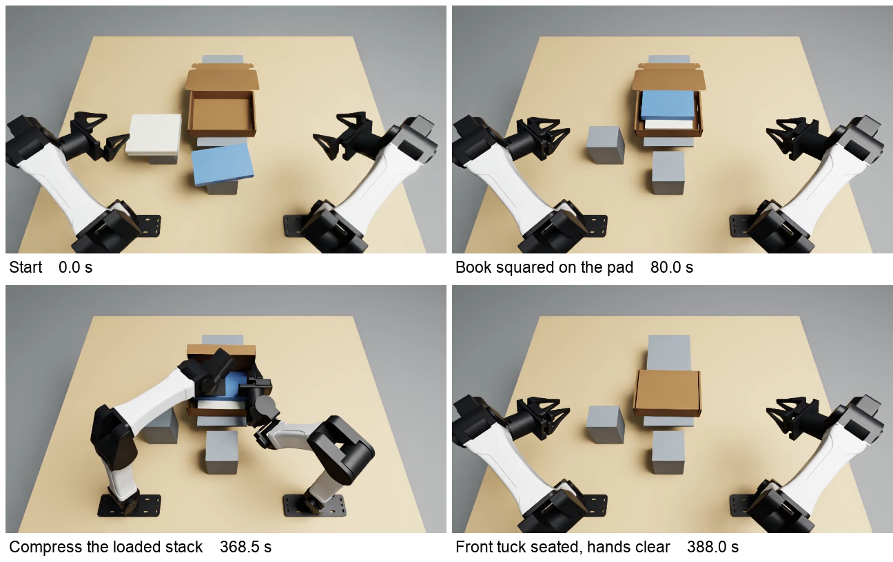
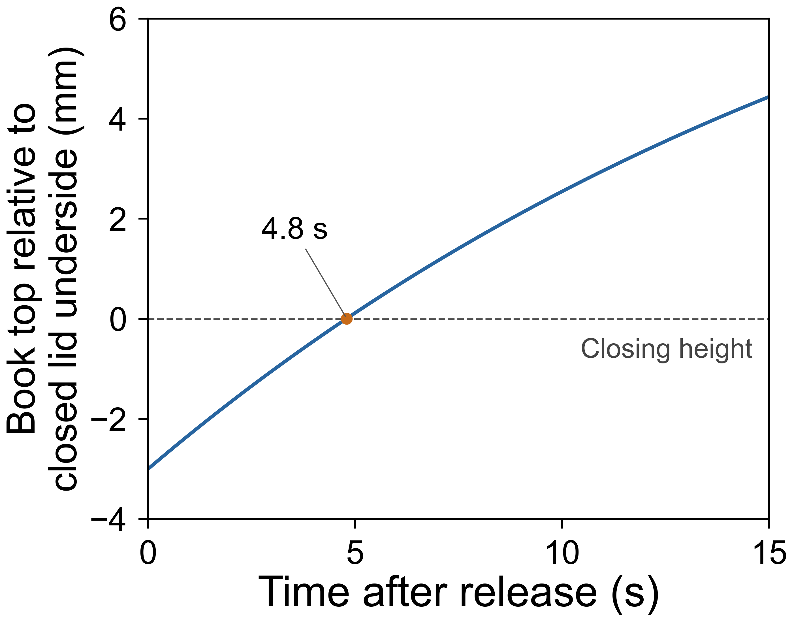

# Pack a paperback by compressing the foam beneath it

Pack the paperback squarely in the carton with the foam pad underneath. Press the book low enough to close the lid, fold the flaps in and tuck the lid inside the front wall. Move both hands clear and leave the carton closed.

The roll-end mailer task asks the robot to form and lock the carton walls. This task starts with those walls standing and shares the final tuck motion. Closing the empty carton earns zero. Loading the book squarely on the uncompressed pad and leaving the lid open earns 0.25. To finish, the robot must also lower the stack to closing height, seat the tuck and leave the loaded carton closed with both hands clear. In the starting geometry, the relaxed stack protrudes 9 mm above the closed lid’s underside.



## Run a trial

Use Linux with the NVIDIA Isaac Sim stack. The reference workstation used an RTX 5090, Python 3.12.16, Isaac Sim 6.1.0.0, Torch 2.11.0+cu128, NumPy 2.3.1, SciPy 1.17.0 and imageio-ffmpeg 0.6.0. The YAM station requires the robot URDF and meshes from its normal installation. Use the environment produced by the YAM setup instructions. The tested revisions are [YAM Arena](https://github.com/kairosiann/yam-isaac-lab-arena/tree/0059d02a1a91bc6834c1d0846022891df0c78730), [Isaac Lab-Arena](https://github.com/isaac-sim/IsaacLab-Arena/tree/c7edf3a9d5d8276565208f72422f8f8a0806d6cf) and Isaac Lab submodule `91a0906f93802eb859192dcb0bca879f891e92d6`. Dream uses Inspect Robots 1.0.0, inspect-robots-dream 0.1.0 and an account with access to `dreamlabs/dream-1-beta`.

Run from this folder, using a new output directory for each trial. If the Arena installation is elsewhere, adjust the first path.

```bash
source "$HOME/IsaacLab-Arena/yam.env"
export OMNI_KIT_ACCEPT_EULA=YES ACCEPT_EULA=Y
python verify_score.py
python run_demo.py out-demo
python run_dream.py out-dream
```

The published Dream-1 video used the earlier instruction, which explicitly asked for the foam first. To repeat that trial, use `python run_dream.py out-dream --recorded-instruction`. The default uses the current task instruction. Both versions ask for the same final stack and use the same scorer.

Read `out-demo/result.json` for the scripted score and `out-dream/inspect/book-package_*.json` for the Inspect score and termination reason. Recordings are `out-demo/three-camera.mp4` and `out-dream/world/three-camera.mp4`. Dream also stores per-camera frames and a policy transcript. The Dream entry point calls the Inspect evaluation API with the scene's custom embodiment. It supplies all three station RGB views and 14 measured joint/gripper values. Only the scripted controller reads privileged geometry and finger contacts.

| Recorded trial | Control steps | Simulated time | Wall time on reference machine | Final score |
| --- | ---: | ---: | ---: | ---: |
| Continuous scripted demonstration | 7,791 | 389.55 s | about 31 min | 1.00 |
| Dream-1, seed 0 | 9,000 | 450.00 s | about 34 min | 0.00 |

The scripted demonstrator loads and squares the book using measured geometry and contact. It then sends taught arm and finger targets from `closure_targets.npz` at 20 Hz. The robot moves the carton through contact throughout the run. The targets contain joint commands and phase labels. The scorer reads the resulting physical state.

The starts are fixed. Both runs use one physics step per millisecond and 20 joint commands per second. The horizon allows 9,000 commands, 1,209 more than the demonstration used. In the reference Dream run the book and pad finished outside the carton. These runs establish feasibility and one policy outcome on this layout. They do not estimate a success rate across layouts.

## Recreate the station

| Item | Size and material | Initial position |
| --- | --- | --- |
| Open mailer | Scored cardboard, 220 × 160 × 50 mm footprint and height, 1.2 mm board | Centered at station x = 350 mm, y = 0. Front wall faces the robots. Four walls stand up, lid open toward the rear. |
| Foam pad | 160 × 136 × 32.8 mm, 25 g | On the left stand, center x = 258 mm, y = 220 mm. Start fully recovered. |
| Paperback | 178 × 108 × 25 mm, 250 g | On the front stand, center x = 155 mm, y = 0. Its long edge starts 10° from the carton's long edge. |
| Work surfaces | Rigid slab and stands | Carton deck 420.6 × 170 × 8 mm, top 125 mm above the station table. Stand tops are 150 mm above the table. Pad stand is 80 × 100 mm and book stand is 100 × 100 mm. |
| Robot | Two station YAM arms with parallel grippers | Empty at the fixed starting poses. Cameras are overhead and on each wrist. |

The carton blank is supplied as [a full-size cutting and crease pattern](assets/carton-dieline.svg). Print at 100%, tile if needed and check its 100 mm scale bar. The blank is 432 × 449 mm. Cut the solid outlines and four slots from 1.2 mm board, then score the dashed lines. Stand up the front and rear walls, fold the corner ears inward, roll both side walls around the ears and insert the side tabs into the base slots. Start with the lid open. Use ordinary blocks for the stands and deck. The narrow stands leave the item edges accessible from below. Starting with the items flat on a bench would require a different pickup. Soft foam, clean cardboard and a paperback or paper block with the listed mass and dimensions are suitable bench props.

Qualify each batch of slow-recovery foam before use. With the book on top, measure how far it stands above the rim. Using a kitchen scale under the stack, apply about 15 N additional load (about 1.5 kg on the scale) for 2.5 seconds and remove it. In the separate simulated material check, the book top went from 9.0 mm above the closing plane to 3.0 mm below, crossed back above after 4.8 s and stood 4.4 mm above after 15 s. At 3 s the fully pressed open-lid control was still 1.04 mm below the closing plane. A separate 10 s closed-lid comparison started both cases at the same height and foam compression. With the tuck inside, the highest lid point rose under 0.001 mm. With the tuck outside, it rose 1.04 mm. Both stayed inside the 3 mm band. Inspect the tuck separately. Record the values for the physical pad and allow full recovery between trials. Recut a worn carton. These are comparison measurements for sourcing a pad. A physical material match has yet to be demonstrated.



## How the score works

Evaluate the terminal state. All credit requires the carton upright on the deck with its four walls standing and four corners captured. Sliding or turning the carton on the deck carries no separate penalty. The checker uses the carton frame. A correction or re-grasp is allowed.

| Points | What the referee checks |
| ---: | --- |
| 0.10 | Pad inside and flat on the box floor. |
| 0.10 | With the pad inside, the whole book lies inside, centered over the pad footprint by its center projection, with its underside within 3 mm of the pad top. |
| 0.05 | With both items loaded, the book's long edge is within 3° of the carton's long edge. Either end can face left. |
| 0.10 | While loaded, the book top reached or passed below the closed lid underside, 49.4 mm above the base midplane. This milestone is retained while scoring a loaded carton. |
| 0.25 | With both items loaded, the tuck lies inside the front wall and its lower edge reaches 32 mm or less above the base midplane. |
| 0.10 | With both items loaded, both side flaps and both tuck ears are inside the walls. All four are required for this component. |
| 0.15 | With both items loaded, the lid faces inward in the closing direction. Its vertices lie within 3 mm of the 50 mm rim plane and its signed normal has z below −0.985 in the box frame. |
| 0.10 | All preceding checks hold together, both grippers are at least 20 mm from the closed parcel, and the carton and contents are stable. |
| 0.05 | Add linearly over the next 3 continuous seconds of satisfying all conditions, up to 1.00 total. Losing a condition restarts this hold. |

A physical run that tears through a wall or removes material to make the load fit earns zero. Those changes cannot be produced by the rigid-panel simulation. Four corner ears are scored. The four base-slot tab insertion tests are diagnostics for the preformed side walls. All four insertion flags were false at the end of the full-score run. Full score certifies the observed front tuck and closed geometry at this station. It supplies no certification of side-tab engagement or transit readiness. The exact corner, panel and book tests are in `pack_check.py` and `PackWorld.measure`. For release, the evaluator checks each hand’s palm and two fingertip collision meshes against the packed carton envelope. The closest conservative bounding-box gap must reach 20 mm on each side. At the bench, use the same clearance against the sides and top of the closed box, with a visible 20 mm reference alongside the parcel and two calibrated camera views. Force measurements are unnecessary for grading. The deck test uses height and tilt. Stability requires tracked vertices to stay within 2 mm of the current position over the preceding second. An empty closed box scores 0.00. A square book on its uncompressed pad in an open box scores 0.25. A correctly packed box still held down earns at most 0.85. A fully released box with every other check satisfied for 1.5 s scores 0.975.

## Bench verification and limitations

For a physical trial, record a calibrated overhead view and an oblique view at the front rim. Use a ruler or a printed angle guide to check the book before the lid hides it. Use the rim as a height reference for compression and a straightedge for final lid height. Track the two side flaps and tuck ears during closure; a contrasting mark on the tuck tip helps distinguish inside from outside. Time the uninterrupted release on video. If the camera cannot see a hidden fold, record close-up evidence at insertion or inspect the fold after the hold before awarding it. A top-down final photograph alone cannot verify all points.

The book is rigid. The foam is represented by two contacting surfaces with one vertical degree of freedom, 12 mm travel, preload and a spring-damper. The carton has rigid panels joined by passive creases. This tests the interaction among stack height, rebound and closure. Panel twist, local crushing, tears, lateral bulging, transit shocks and product damage are outside the model. A separate instrument audit of the scripted trajectory found per-finger contact sums averaged over one second stayed below 8.7 N. The highest recorded fingertip-to-object peak was 16.70 N during final lid seating. No interval exceeded 40 N across the measured finger contacts. The material parameters and loads still require physical validation.
